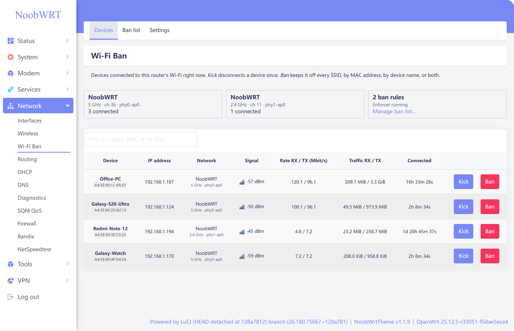
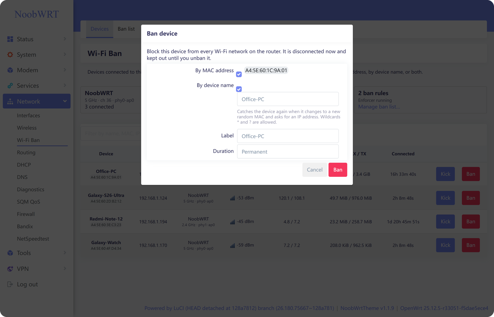
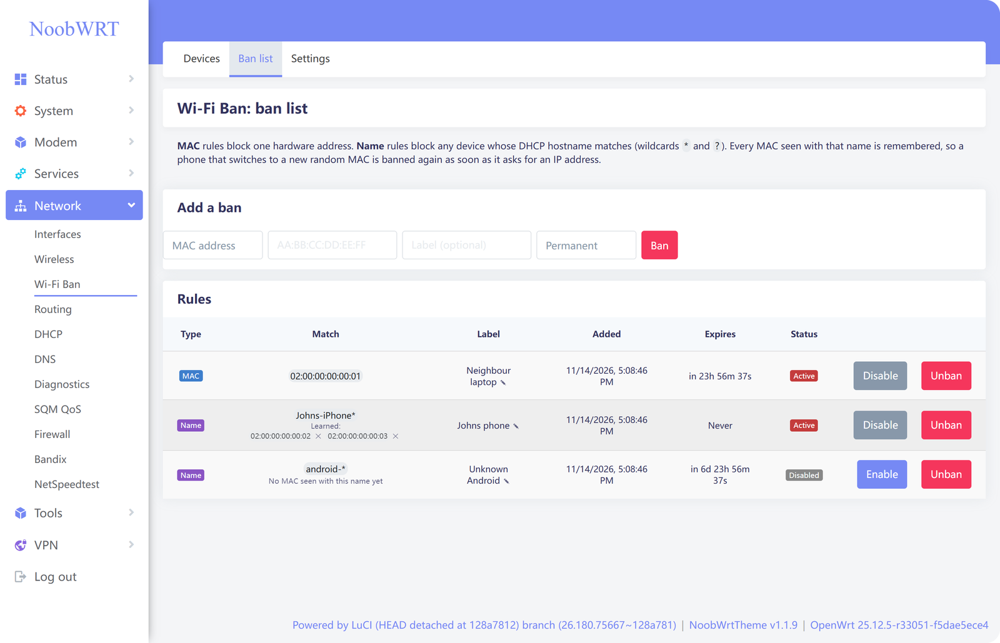

# luci-app-wban

<p align="center">
  
</p>

<p align="center">
  <b>See who is on your Wi-Fi. Kick them. Ban them.</b><br>
  A simple Wi-Fi client manager for OpenWrt's LuCI web interface.
</p>

<p align="center">
  
  
  
  
</p>

<p align="center">
  <a href="#features">Features</a> •
  <a href="#screenshots">Screenshots</a> •
  <a href="#installation">Installation</a> •
  <a href="#usage">Usage</a> •
  <a href="#good-to-know">Good to know</a>
</p>

---

## Features

- **Live device list**: name, MAC, IP, SSID, band, signal, speed, traffic and uptime for every connected client.
- **One-click Kick or Ban** from the device list.
- **Ban by MAC or by device name.** Name bans support wildcards (`Galaxy-S23*`), so a phone that switches to a new random MAC still gets caught.
- **Temporary bans**: 1 hour, 3 hours, 1 day, 1 week or 30 days. They lift themselves automatically.
- **Works on every SSID and band.** Banned devices cannot connect at all.
- **No Wi-Fi restart needed.** Other clients are never dropped when you ban or unban.
- **Bans survive reboots** and Wi-Fi reloads.
- **Never-ban list** for your own devices, so you cannot lock yourself out.

## Screenshots

<table>
  <tr>
    <td width="50%"></td>
    <td width="50%"></td>
  </tr>
  <tr>
    <td align="center"><b>Ban dialog</b>: by MAC, by device name, or both</td>
    <td align="center"><b>Ban list</b>: name rules remember every MAC they catch</td>
  </tr>
</table>

## Requirements

- OpenWrt 23.05 or newer
- Standard `hostapd` / `wpad` (included in OpenWrt by default)

## Installation

Copy the app onto your router (replace `192.168.1.1` with your router's IP):

```sh
scp -O -r luci-app-wban/root/* root@192.168.1.1:/
scp -O -r luci-app-wban/htdocs/* root@192.168.1.1:/www/
ssh root@192.168.1.1 'apk add ucode-mod-uloop 2>/dev/null || opkg install ucode-mod-uloop; \
  sh /etc/uci-defaults/80_luci-wban && rm /etc/uci-defaults/80_luci-wban; /etc/init.d/rpcd restart'
```

Then refresh LuCI in your browser.

## Usage

Open LuCI and go to **Network → Wi-Fi Ban**.

| Tab | What you can do |
|---|---|
| **Devices** | See everyone connected and **Kick** or **Ban** them. |
| **Ban list** | View, add, enable/disable, edit or remove bans. Set an expiry time. |
| **Settings** | Turn banning on or off, manage your **never-ban list**, and enable logging. |

### Command line (optional)

You can also manage bans over SSH:

```
wban clients                          list connected devices
wban rules                            list bans
wban ban-mac aa:bb:cc:dd:ee:ff "Neighbour" 3600
wban ban-name 'Galaxy-S23*' "Kid tablet"
wban unban <id|mac|pattern>
wban kick <mac>
```

## Good to know

- **Name bans need a hostname.** They only work if the device sends its name when it connects. iPhones usually do; many Android phones using random MACs do not.
- **New random MACs are caught on connect.** The device may appear for a moment before it is kicked and kept out.
- **This is not a security tool.** Someone who changes both their MAC and device name can get back in. Use a strong Wi-Fi password (WPA2/WPA3) for real access control.

## License

MIT. See [LICENSE](LICENSE).
